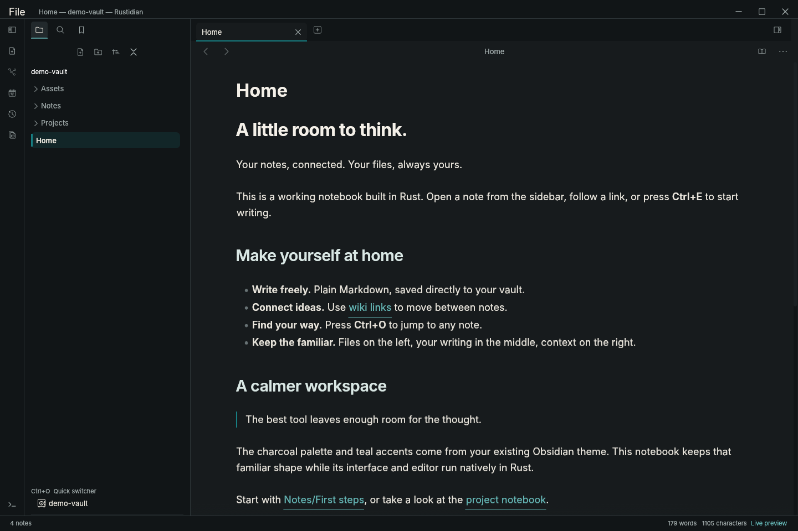

<div align="center">


# Rustidian: Obsidian but fast.

**A Rust-based Obsidian.**

[Download Linux alpha](https://github.com/MasihMoafi/rustidian/releases) · [Quick start](#quick-start) · [Performance](#performance) · [Contribute](CONTRIBUTING.md)

Early alpha · Full Obsidian parity is unfinished

</div>

I built Rustidian because I wanted a note editor that felt fast. I liked Obsidian, but startup still felt slow after several optimization attempts. Rustidian brings that familiar vault workflow to a native Rust app: ordinary Markdown folders, live editing, linked notes and graphs.

**Try the Linux alpha. Contributors are welcome.**

## Development status

Rustidian is a work in progress toward a complete, fast Obsidian-style app. The current build covers a subset of that goal.

| Area | Current state |
| --- | --- |
| Markdown editing, links, tasks, tables, Mermaid | Implemented workflows with ongoing parity work |
| Vaults, daily notes, templates, workspaces, recovery | Implemented workflows with remaining gaps |
| Global and local graph | Native views verified; graph parity work continues |
| Canvas, Bases, math, full settings and hotkeys | Missing or incomplete |
| Existing Obsidian community plugins | Unsupported; compatibility design remains open |

The [coverage ledger](docs/PARITY.md) records implemented workflows and remaining work. Full parity and existing Obsidian plugin compatibility are unfinished.



## Why Rustidian?

- **Native throughout.** Rust powers the interface, text editor, Markdown renderer, search, and vault operations.
- **Write your way.** Live editing, source and reading modes, folding, formatting, find/replace, and undo. Tables, callouts, images, syntax highlighting, and native Mermaid diagrams bring your notes to life.
- **Follow your ideas.** Wiki links, backlinks, tags, aliases, properties, bookmarks, a quick switcher, and vault-wide search keep your knowledge connected.
- **Return to your rhythm.** Daily notes, templates, pinned tabs, named workspaces, recent vaults, and tab restoration after a clean exit.
- **Keep control of your files.** Plain UTF-8 Markdown and text, atomic saves, external-change protection, recovery snapshots, and recoverable Trash. Workspace state lives outside the vault.

## Quick start

The current preview is built and verified on **Linux x86_64 / X11**.

1. Download the Linux archive and `SHA256SUMS` from [Releases](https://github.com/MasihMoafi/rustidian/releases).
2. Verify the archive, extract it and run the application from that directory:

```sh
sha256sum --check SHA256SUMS
tar -xzf rustidian-v0.1.0-alpha.1-linux-x86_64.tar.gz
./rust-notes
```

The included `demo-vault` opens by default. Keep it beside the executable, or pass your own folder or document:

```sh
./rust-notes "/path/to/vault"
./rust-notes "/path/to/note.md"
./rust-notes "/path/to/document.txt"
```

The File menu provides **Open file…** and **Open folder…**; the separate vault chooser keeps recent vaults and creation.

The Linux alpha includes exact build information and checksums. The published package is built from `6347d49`; newer work on the main branch may differ. Maintainers can also use the final optimized package from [Native Rust Actions](https://github.com/MasihMoafi/rustidian/actions/workflows/native.yml). Actions artifacts expire after **one day**; debug candidates are for disposable checks.

Edits autosave after 600 ms of inactivity; **Ctrl+S** saves immediately. If another program changes a note, Rustidian retains your buffer and refuses to overwrite the external change. Use **Save a copy** from the command palette to preserve your version.

| Shortcut | Action |
| --- | --- |
| Ctrl+P | Command palette |
| Ctrl+O | Quick switcher |
| Ctrl+Shift+O | Open an existing file |
| Ctrl+Alt+O | Open an existing folder as a vault |
| Ctrl+N | New note |
| Ctrl+E | Switch reading/editing |
| Ctrl+Shift+F | Search the vault |
| Ctrl+S | Save |

## Performance

A [verified same-host comparison](https://github.com/MasihMoafi/rustidian/actions/runs/39817952278) measured serial edit/save acknowledgement:

| Editor | Median |
| --- | ---: |
| **Rustidian alpha** | **78.57 ms** |
| Ferrite 0.3.0 | 439.32 ms |

**About 5.6× faster in this edit-and-save test.** Both editors used the same 103,300-byte document in source mode on one Linux/Xvfb host. Four alternating rounds collected 100 timed samples plus 20 warmups. Timings cover synthetic input through observing the exact saved bytes, including keyboard-driver and file-polling overhead. Overall speed varies by workload.

A separate [paired startup comparison](docs/performance/startup-2026-10-22/README.md) measured a median complete matching note frame at **0.61 s for the verified Rustidian baseline versus 3.77 s for Obsidian 1.14.4**. Ten balanced warmed pairs used 100 synthetic notes, a 1440×960 software display and screenshot/OCR sampling. The measured baseline precedes the later graph update. Exact versions, original paired screenshots, raw results and limits accompany this bounded result.

The linked run contains the verification evidence. See the [comparison script](scripts/compare-editors.py) for the method and the [workflow](.github/workflows/native.yml) for the checks.

## Contributors welcome

Help shape it early: Rust/egui development, Markdown editing, file safety, accessibility, platform support and reproducible bug reports all matter. See [CONTRIBUTING.md](CONTRIBUTING.md) and the [coverage ledger](docs/PARITY.md).

[MIT license](LICENSE) · Independent project, unaffiliated with Obsidian. Existing Obsidian JavaScript plugins are unsupported; full feature and visual parity remain unfinished.
