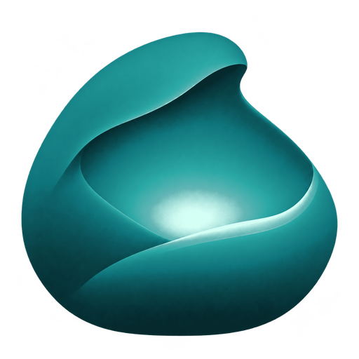
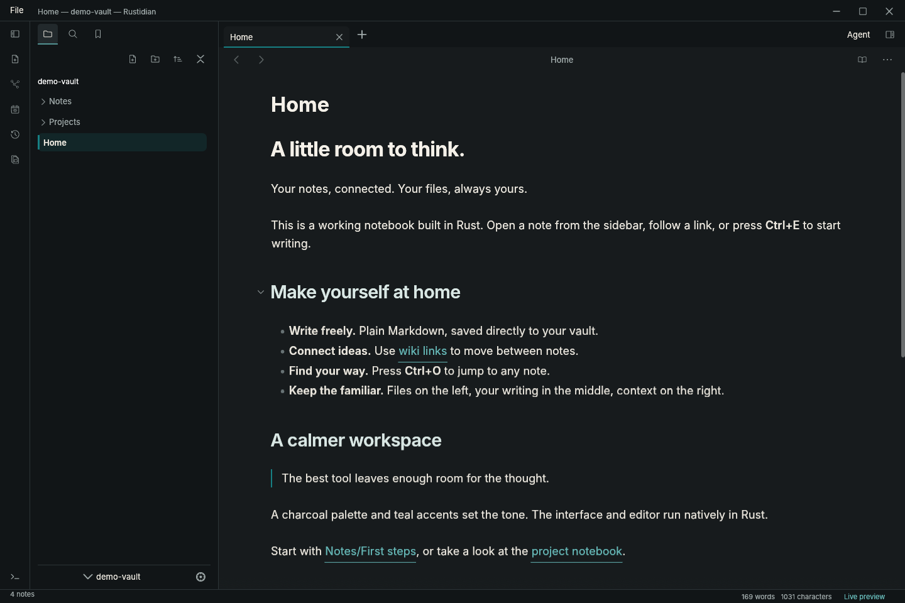
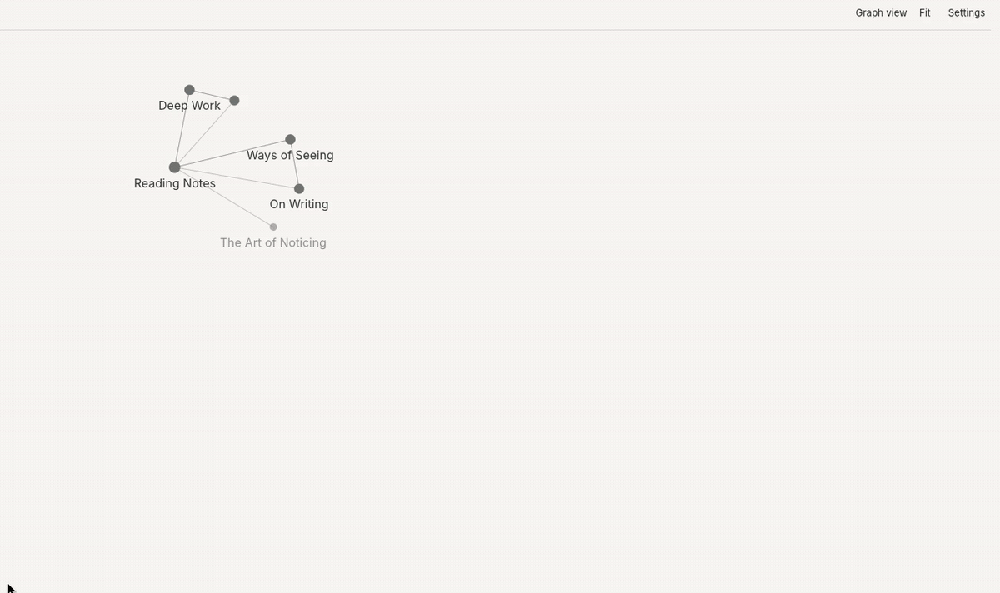
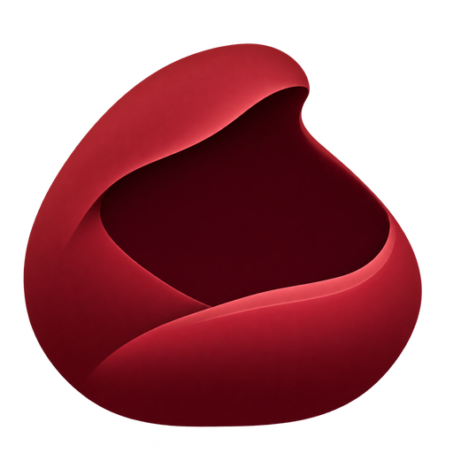
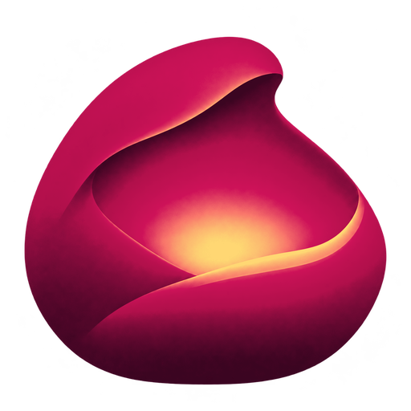

<div align="center">



# Rustidian

### Like Obsidian, but fast.<br>A native Markdown notebook for Linux. Your files, no account.

[](https://github.com/MasihMoafi/rustidian/releases/latest)
[](#quick-start)
[](https://www.rust-lang.org)
[](LICENSE)
[](https://github.com/MasihMoafi/rustidian/stargazers)

<a href="https://github.com/MasihMoafi/rustidian/releases/latest/download/rustidian-linux-amd64.deb"></a>
&nbsp;
<a href="#quick-start"></a>

Opens your Obsidian vaults as they are. Started in **0.61 s vs Obsidian's 3.77 s** in our [paired test](docs/performance/startup-2026-10-22/README.md).<br><sub>Independent project, not affiliated with Obsidian.</sub>

</div>

<br>

<picture>
  <source media="(prefers-color-scheme: light)" srcset="docs/images/rustidian-light.png">
  
</picture>

I built Rustidian for myself because every note editor I tried felt too slow. **Speed and stability** guide it: ordinary Markdown folders, native editing, linked notes and graphs. Contributors are welcome.



## New in 0.1.7: listen and dictate

<table>
<tr>
<td width="50%" valign="top">

### 🔊 Hear any passage

Select text and a red speaker appears beside it: it reads only those sentences. The toolbar speaker reads the whole note, in reading and editing views. Markdown symbols are skipped, at speeds up to 2×.

</td>
<td width="50%" valign="top">

### 🎙️ Dictate into a note

Click the microphone, speak, click again. The text lands at your cursor as one edit you can undo.

Both run on your own [OpenRouter](https://openrouter.ai) key, kept in your system keyring, or fully on your machine with [Kokoro](https://github.com/thewh1teagle/kokoro-onnx) and [WhisperType](https://github.com/MasihMoafi/WhisperType).

</td>
</tr>
</table>

https://github.com/user-attachments/assets/ffa86f67-2869-4b31-a748-9938c9ab750f

<p align="center"><sub>Three sentences selected in turn; each red speaker reads only its sentence. Turn the sound on.</sub></p>

https://github.com/user-attachments/assets/f63fccee-77ce-4d7c-96f2-584041b21f45

<p align="center"><sub>The microphone turns red while recording; the transcript appears at the cursor.</sub></p>

### 🎨 Four palettes, logo included

<table>
  <tr>
    <td align="center"><br><sub>Teal</sub></td>
    <td align="center"><br><sub>Love Space</sub></td>
    <td align="center"><br><sub>Elpis Gold</sub></td>
    <td align="center"><br><sub>Signature</sub></td>
  </tr>
</table>

## Why Rustidian?

<table>
<tr>
<td width="33%" valign="top"><b>⚡ Native throughout</b><br>Rust powers the interface, editor, Markdown renderer, search and vault operations.</td>
<td width="33%" valign="top"><b>✍️ Write your way</b><br>Live, source and reading modes. Tables, callouts, images, LaTeX math and native Mermaid diagrams.</td>
<td width="33%" valign="top"><b>🔗 Follow your ideas</b><br>Wiki links, backlinks, tags, aliases, properties, bookmarks and vault-wide search.</td>
</tr>
<tr>
<td valign="top"><b>📅 Return to your rhythm</b><br>Daily notes, templates, pinned tabs, named workspaces and tab restoration.</td>
<td valign="top"><b>🤖 Work beside an agent</b><br>The Agent tab (Ctrl+Shift+A) runs Codex, Claude Code or Elpis in your vault folder.</td>
<td valign="top"><b>🛡️ Keep control of your files</b><br>Plain Markdown, atomic saves, external-change protection, recovery snapshots and a recoverable Trash.</td>
</tr>
</table>

## Quick start

Needs Linux x86_64 with **glibc 2.39 or newer** (Ubuntu 24.04+; check with `ldd --version`) and an X11 or Wayland desktop.

Download the **[Debian/Ubuntu package](https://github.com/MasihMoafi/rustidian/releases/latest/download/rustidian-linux-amd64.deb)** and its [checksums](https://github.com/MasihMoafi/rustidian/releases/latest/download/SHA256SUMS), then:

```sh
sha256sum --check --ignore-missing SHA256SUMS
sudo apt install ./rustidian-linux-amd64.deb
rustidian
```

The first launch opens a writable demo vault. To use your own notes, try a copy of your vault first: **File → Open folder…**, no import or account needed.

<details>
<summary><b>Other ways to install</b>: Snap, AppImage, Arch, portable archive</summary>

- **Snap:** `sudo snap install rustidian`. It reads vaults in your home folder; `sudo snap connect rustidian:removable-media` opens vaults on other drives.
- **AppImage:** download it from the [latest release](https://github.com/MasihMoafi/rustidian/releases/latest), `chmod +x` it and run it.
- **Arch and Omarchy:** `git clone https://github.com/MasihMoafi/rustidian && cd rustidian/packaging/aur-bin && makepkg -si` builds a native package from the release's exact executable.
- **Portable:** download the [tar archive](https://github.com/MasihMoafi/rustidian/releases/latest/download/rustidian-linux-x86_64.tar.gz) and the checksums. The Open dialogs need `zenity`.

  ```sh
  sha256sum --check --ignore-missing SHA256SUMS
  mkdir rustidian && tar -xzf rustidian-linux-x86_64.tar.gz -C rustidian
  cd rustidian && ./rustidian            # python3 install.py adds it to your menu
  ```

</details>

<details>
<summary><b>Keyboard shortcuts</b></summary>

| Shortcut | Action |
| --- | --- |
| Ctrl+P | Command palette |
| Ctrl+O | Quick switcher |
| Ctrl+Shift+O | Open an existing file |
| Ctrl+Alt+O | Open an existing folder as a vault |
| Ctrl+N | New note |
| Ctrl+E | Switch reading/editing |
| Ctrl+Shift+F | Search the vault |
| Ctrl+S | Save |

</details>

<details>
<summary><b>Coming from Obsidian?</b> Why plugins don't run, and how saving works</summary>

Rustidian reads ordinary Markdown files and selected Obsidian settings. Its interface is native Rust (egui/eframe); Obsidian plugins need Obsidian's JavaScript API and often its browser DOM, so they do not run. Canvas and Bases are missing; keep Obsidian for those.

Edits autosave after 600 ms of inactivity; **Ctrl+S** saves at once. If another program changes a note, Rustidian keeps your buffer and refuses to overwrite the outside change; **Save a copy** keeps your version.

</details>

## Speed

| Test | Rustidian | Other |
| --- | ---: | ---: |
| [Startup to a complete note](docs/performance/startup-2026-10-22/README.md) | **0.61 s** | Obsidian 1.14.4: 3.77 s |
| [Edit-and-save acknowledgement](https://github.com/MasihMoafi/rustidian/actions/runs/39817952278) | **78.57 ms** | Ferrite 0.3.0: 439.32 ms |
| [Memory with a note open](docs/performance/footprint-2026-11-08/README.md) | **98 MB** | Obsidian 1.5.12: 284 MB |
| [Linux download](docs/performance/footprint-2026-11-08/README.md) | **28 MB** | Obsidian 1.5.12: 108 MB |

<sub>Startup and save were measured on older builds; memory (whole process tree, PSS) and download on 8 Nov 2026 with the same vault on one Linux machine. Method and limits are in the linked reports and the [comparison script](scripts/compare-editors.py).</sub>

## Status

A work in progress toward full support for Obsidian-format vaults.

| Area | State |
| --- | --- |
| Markdown editing, links, tasks, tables, Mermaid, LaTeX math | ✅ Works; parity work continues |
| Vaults, daily notes, templates, workspaces, recovery | ✅ Works, with gaps |
| Global and local graph | ✅ Works; parity work continues |
| Canvas, Bases, full settings and hotkeys | 🚧 Missing or incomplete |
| Obsidian community plugins | ❌ Unsupported |

The [coverage ledger](docs/PARITY.md) lists what works and what is left.

## Contribute

Open a copied vault, edit and save a note, follow a link, then reopen it. [Report what broke](https://github.com/MasihMoafi/rustidian/issues/new?template=bug_report.yml) with `rustidian --version` and your Linux setup, or a [difference from Obsidian](https://github.com/MasihMoafi/rustidian/issues/new?template=parity_gap.yml). Rust/egui contributors can start with Markdown rendering, keyboard access or Wayland testing; see [CONTRIBUTING.md](CONTRIBUTING.md).

If Rustidian is useful to you, a ⭐ helps others find it.

<div align="center"><sub><a href="LICENSE">MIT license</a> · <a href="THIRD_PARTY_NOTICES.txt">Third-party notices</a> · Independent, not affiliated with Obsidian.</sub></div>

<!-- more-projects:start -->
## More projects

- [Elpis](https://github.com/MasihMoafi/Elpis): a coding agent for the terminal and desktop, with explicit context control
- [rag-mcp](https://github.com/MasihMoafi/rag-mcp): local hybrid search over your documents, as a CLI and MCP server
- [Skills](https://github.com/MasihMoafi/skills): SKILL.md workflows for coding agents
- [WhisperType](https://github.com/MasihMoafi/WhisperType): local voice input for developers
- [Read Aloud](https://github.com/MasihMoafi/read-aloud): select text, press Super+R, hear it in a local voice
- [Love Spot](https://github.com/MasihMoafi/love-spot): a shared drawing board where characters talk, draw and compete with you
- [SVG Studio](https://svg.masihmoafi.com): high-quality image vectorization
- [Pin](https://github.com/MasihMoafi/pin): an always-on-top priority note, saved as plain Markdown
- [Clocki](https://github.com/MasihMoafi/clocki): a floating desktop timer for tracking focus hours

All of them: [masihmoafi.com](https://masihmoafi.com/projects)
<!-- more-projects:end -->
