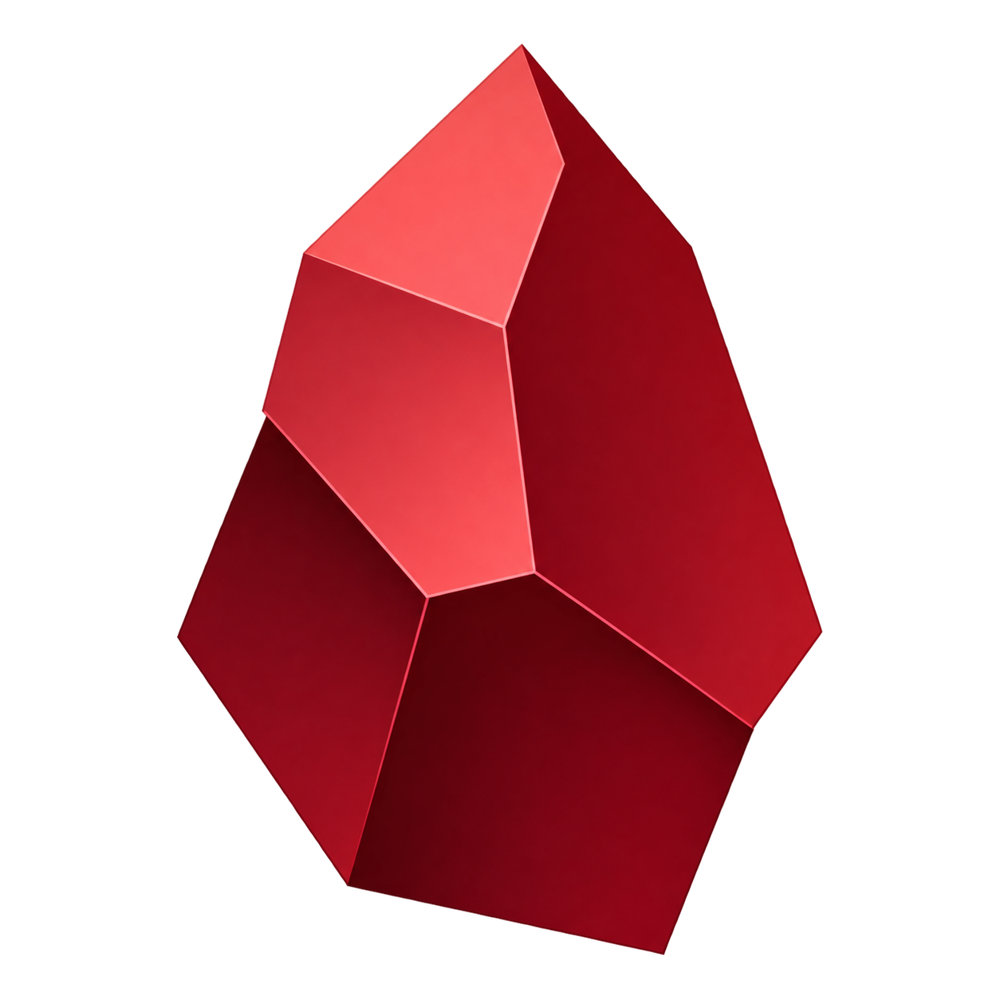
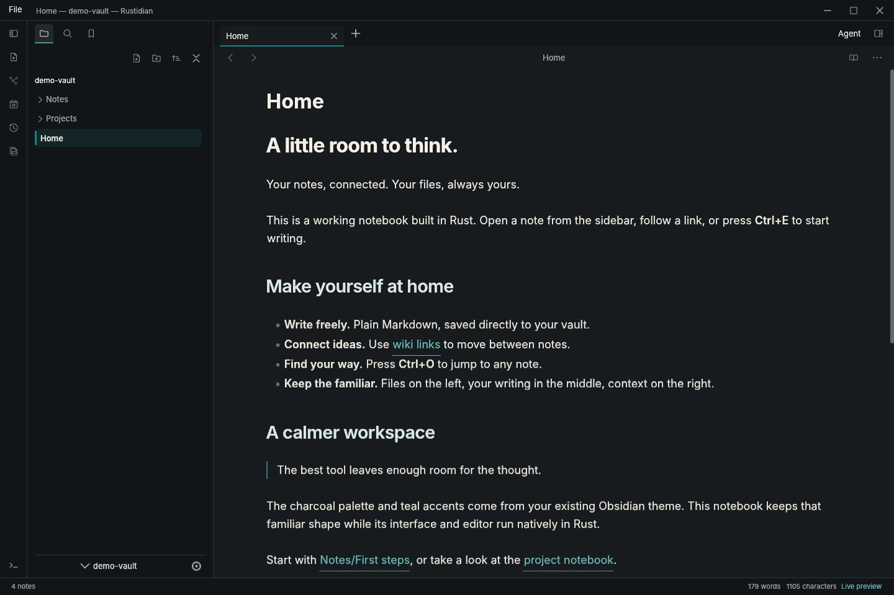

<div align="center">

# Rustidian: Obsidian but fast.

<table>
  <tr>
    <td align="center"><br><sub>Main · Original teal</sub></td>
    <td align="center"><br><sub>Love Space</sub></td>
    <td align="center"><br><sub>Elpis Gold</sub></td>
    <td align="center"><br><sub>Website gradient</sub></td>
  </tr>
</table>

**A native Markdown notebook for Linux. Your files, your folders, no account.**

[Download Linux alpha](https://github.com/MasihMoafi/rustidian/releases) · [Quick start](#quick-start) · [Performance](#performance) · [Report a bug](https://github.com/MasihMoafi/rustidian/issues/new/choose) · [Contribute](CONTRIBUTING.md)

Early alpha · Full Obsidian parity is unfinished

</div>

I built Rustidian for myself because every note editor I tried felt too slow, especially Obsidian. **Speed and stability** guide the project: ordinary Markdown folders, native editing, linked notes and graphs.

**Try the Linux alpha. Contributors are welcome.**



## Quick start

The Linux x86_64 alpha is verified on X11; broader platform coverage remains open.

**Upgrading from alpha.1?** This package uses the `rustidian` command and includes the incremental undo, file-watcher fallback and file-link repairs. Existing settings, recent vaults and recovery are retained. For an older download, use the [alpha.1 instructions](https://github.com/MasihMoafi/rustidian/releases/tag/v0.1.0-alpha.1).

Download `rustidian-linux-x86_64.tar.gz` and its matching `.sha256` file from [Releases](https://github.com/MasihMoafi/rustidian/releases), then:

```sh
sha256sum --check rustidian-linux-x86_64.tar.gz.sha256
tar -xzf rustidian-linux-x86_64.tar.gz
./rustidian
```

The bundled demo opens immediately. To add Rustidian to your applications menu, run `python3 install.py`; it installs for your user without root. You can also run it from the extracted folder:

```sh
./rustidian "/path/to/vault copy"
./rustidian "/path/to/note.md"
./rustidian --version
```

**Coming from Obsidian?** Try a copy of your vault first. Open the folder directly with **File → Open folder…**; no import or account is needed. Rustidian reads ordinary Markdown files and selected Obsidian settings. Community plugins do not run; Canvas, Bases, math and other gaps are listed below. Keep Obsidian available for workflows the alpha does not cover.

Edits autosave after 600 ms of inactivity; **Ctrl+S** saves immediately. If another program changes a note, Rustidian retains your buffer and refuses to overwrite the external change. Use **Save a copy** from the command palette to preserve your version.

| Shortcut | Action |
| --- | --- |
| Ctrl+P | Command palette |
| Ctrl+O | Quick switcher |
| Ctrl+Shift+O | Open an existing file |
| Ctrl+Alt+O | Open an existing folder as a vault |
| Ctrl+N | New note |
| Ctrl+E | Switch reading/editing |
| Ctrl+Shift+F | Search the vault |
| Ctrl+S | Save |

## Why Rustidian?

- **Native throughout.** Rust powers the interface, text editor, Markdown renderer, search, and vault operations.
- **Write your way.** Live editing, source and reading modes, folding, formatting, find/replace, and undo. Tables, callouts, images, syntax highlighting, and native Mermaid diagrams bring your notes to life.
- **Follow your ideas.** Wiki links, backlinks, tags, aliases, properties, bookmarks, a quick switcher, and vault-wide search keep your knowledge connected.
- **Return to your rhythm.** Daily notes, templates, pinned tabs, named workspaces, recent vaults, and tab restoration after a clean exit.
- **Keep control of your files.** Plain UTF-8 Markdown and text, atomic saves, external-change protection, recovery snapshots, and recoverable Trash. Workspace state lives outside the vault.

## Development status

Rustidian is a work in progress toward a complete, fast Obsidian-style app. The current build covers a subset of that goal.

| Area | Current state |
| --- | --- |
| Markdown editing, links, tasks, tables, Mermaid | Implemented workflows with ongoing parity work |
| Vaults, daily notes, templates, workspaces, recovery | Implemented workflows with remaining gaps |
| Global and local graph | Native views verified; graph parity work continues |
| Canvas, Bases, math, full settings and hotkeys | Missing or incomplete |
| Existing Obsidian community plugins | Unsupported; compatibility design remains open |

The [coverage ledger](docs/PARITY.md) records implemented workflows and remaining work. Full parity and existing Obsidian plugin compatibility are unfinished.

## Performance

A [paired startup comparison](docs/performance/startup-2026-10-22/README.md) measured a median complete matching note frame at **0.61 s for the verified Rustidian baseline versus 3.77 s for Obsidian 1.14.4**. Ten balanced warmed pairs used 100 synthetic notes, a 1440×960 software display and screenshot/OCR sampling. The measured baseline precedes the later graph update. Exact versions, original paired screenshots, raw results and limits accompany this bounded result.

A [verified same-host comparison](https://github.com/MasihMoafi/rustidian/actions/runs/39817952278) measured serial edit/save acknowledgement:

| Editor | Median |
| --- | ---: |
| **Rustidian alpha** | **78.57 ms** |
| Ferrite 0.3.0 | 439.32 ms |

**About 5.6× faster in this edit-and-save test.** Both editors used the same 103,300-byte document in source mode on one Linux/Xvfb host. Four alternating rounds collected 100 timed samples plus 20 warmups. Timings cover synthetic input through observing the exact saved bytes, including keyboard-driver and file-polling overhead. Overall speed varies by workload.

The linked run contains the verification evidence. See the [comparison script](scripts/compare-editors.py) for the method and the [workflow](.github/workflows/native.yml) for the checks.

## Contributors welcome

Try one useful workflow: open a copied vault, edit and save a note, follow a link, then reopen it. [Report what broke](https://github.com/MasihMoafi/rustidian/issues/new?template=bug_report.yml) with `rustidian --version`, your Linux/display setup and a small example. For a difference from Obsidian, use the [workflow gap form](https://github.com/MasihMoafi/rustidian/issues/new?template=parity_gap.yml).

Rust/egui contributors can start with Markdown rendering, keyboard access or Linux/Wayland testing. [CONTRIBUTING.md](CONTRIBUTING.md) explains setup and checks; the [coverage ledger](docs/PARITY.md) records remaining work. If Rustidian is useful to you, a [GitHub star](https://github.com/MasihMoafi/rustidian) helps others discover it.

[MIT license](LICENSE) · Independent project, unaffiliated with Obsidian. Existing Obsidian JavaScript plugins are unsupported; full feature and visual parity remain unfinished.
