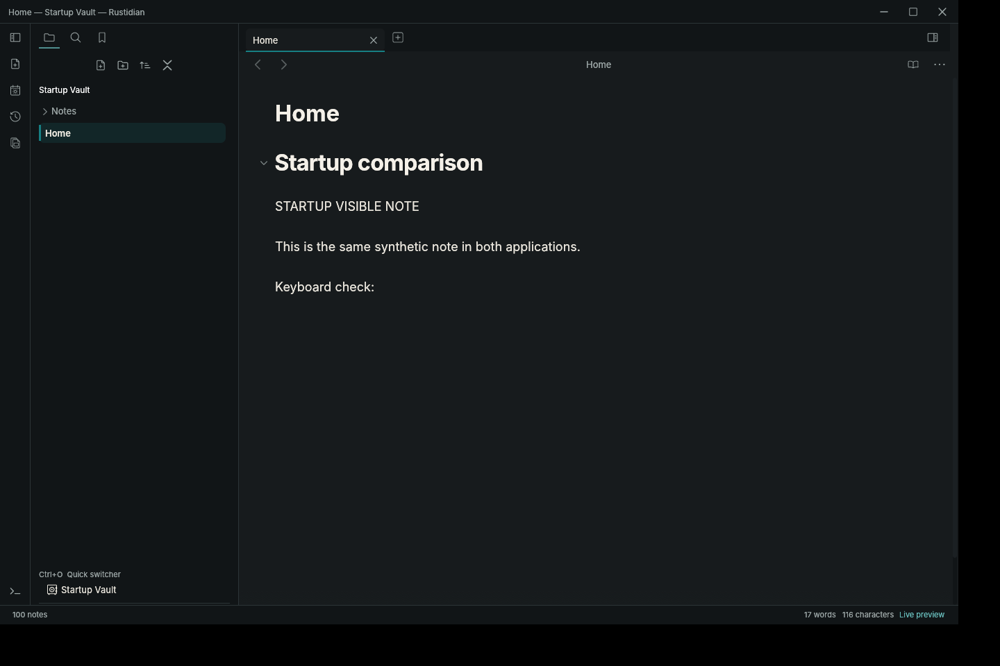
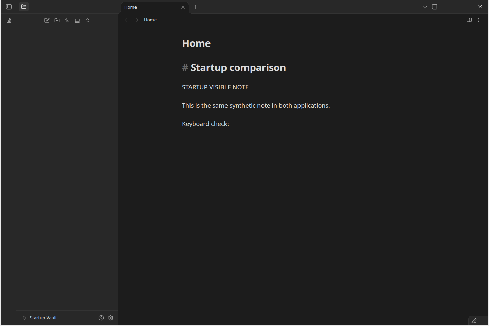
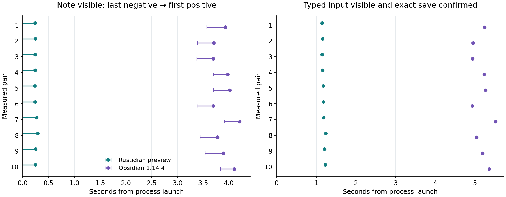

# The same note, from launch to usable input

On 22 October 2026, the optimized Rustidian c7 development preview displayed
the matching note sooner in all ten warmed pairs on this host.

| Median of ten launches each | Rustidian preview | Obsidian 1.14.4 |
| --- | ---: | ---: |
| First matching note capture | 0.24 s | 3.91 s |
| Typed input visible and exact save confirmed | 1.18 s | 5.21 s |

Five warmup pairs preceded ten measured pairs with balanced launch order.
Both apps used matching copies of a 100-note / 8,135-byte synthetic vault,
Live editing, no community plugins and matching recovery settings. All measured
launches succeeded; nine readiness controls returned their expected outcomes.

| Rustidian preview: note detected at 0.24 s | Obsidian 1.14.4: note detected at 3.93 s |
| --- | --- |
|  |  |

The images record each app's own observation time. They are original captures,
not a reconstruction or simultaneous frame. Open the [interactive comparison](report.html)
locally to switch between the retained screenshot pairs and input stages.

This is a small warmed workload on one busy Linux host, using private Xvfb,
software rendering and screenshot/OCR sampling. Rustidian was visible in its
first post-window capture, so its capture time is an upper observation bound.
Input/save timing includes detector, focus, typing and confirmation overhead.
No cold-cache, physical-display latency, large-vault, full-feature parity or
universal speed claim follows. The measured c7 preview did not pass its complete
release verification; this is not a benchmark of a later release.

[Raw measurements](raw.csv) · [Predeclared protocol](protocol.md) ·
[Settings and input recipe](settings.json) · [Controls](controls.json) ·
[Exact versions, identities, setup failures and limits](technical-appendix.md)
